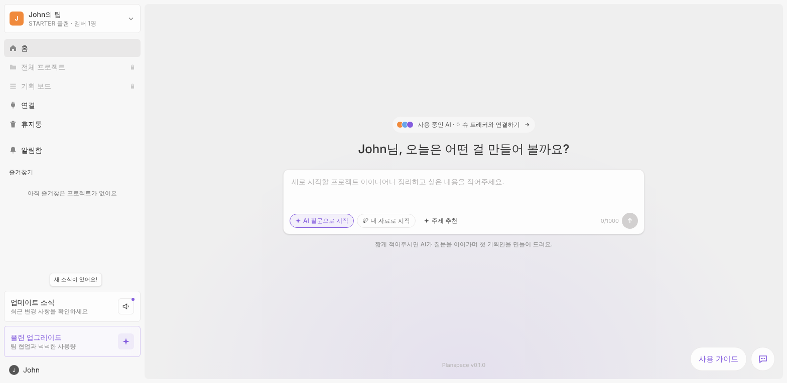

# Planspace (workspace UI clone)

AI 기획 워크스페이스의 로그인 후 화면 구조와 동작을 재현한 Next.js 데모입니다.
레이아웃, 색상, 글꼴, 메뉴 동작은 참고 서비스의 실제 화면을 측정해 맞췄고,
브랜드 이름, 문구, 이미지는 모두 자체 콘텐츠로 바꿨습니다.

## 실행

```bash
npm install
npm run dev   # http://localhost:3000
```

## 기능

| 영역 | 동작 |
| --- | --- |
| 홈 | 아이디어를 적으면 새 프로젝트가 만들어지고 기획 에디터가 열림. AI 질문 / 내 자료 / 주제 추천 모드 |
| AI 채팅 | 여섯 가지 질문(선택지 + 직접 입력, 답 고치기, 질문 더 받기)으로 범위를 정한 뒤 PRD 생성. "OO 기능 추가해줘", "(기능) 구체화해줘", "검토해줘" 요청 처리 |
| PRD | 문서 구조, 완성도, 항목별 인라인 편집 |
| 기능명세서 | 그래프 / 디렉터리 / 문서 보기, 상태·역할·중요도 필터, 검색, 기능 상세(상태, 중요도, 역할, 근거, 성공 기준, 수용 기준, 코멘트), 기능·묶음 추가와 삭제 |
| AI 수정안 승인 | 채팅이나 검토에서 나온 수정·추가안을 하나씩 또는 한꺼번에 승인·거절 |
| 검토 | 개발, 사업, UX·디자인, QA, 보안, 운영 여섯 관점의 의견, 보류 / 해결 / 채팅에서 해결하기(선택지 카드) |
| 유저플로우 | 기능 묶음별 스윔레인, 시작·페이지·팝업·분기 도형과 화살표 |
| 와이어프레임 | 주요 기능별 흑백 화면 시안 |
| 기획실 | 회의록을 붙여 넣으면 확정·미정·기각 결정을 뽑고, 확정된 결정을 기획서에 반영 |
| 코멘트, 버전 | 기능별·프로젝트 코멘트, 버전 저장과 되돌리기, 작업 로그 |
| 공유 | Markdown, 엑셀(CSV), JSON 내보내기, 클립보드 복사 |
| 프로젝트 관리 | 전체 프로젝트, 즐겨찾기, 휴지통(되살리기, 완전 삭제) |

데이터는 브라우저 localStorage에 저장됩니다. AI 생성은 `lib/generator.ts`의 로컬 규칙 기반 생성기가 맡고 있어서,
실제 언어 모델을 붙이려면 이 파일의 함수들을 API 호출로 바꾸면 됩니다.

## 배포

`main`에 푸시하면 `.github/workflows/pages.yml`이 정적 사이트를 만들어 GitHub Pages에 올립니다.
직접 만들려면 `BASE_PATH=/project npm run build` 후 `out/` 폴더를 올리면 됩니다.

## 디자인 토큰

`app/globals.css`의 `@theme`에 정리했습니다. 기본 글꼴은 Pretendard,
주 색상은 `#845dde`, 본문 `#333`, 테두리 `#e9e8e8`, 캔버스 `#efefef`입니다.


